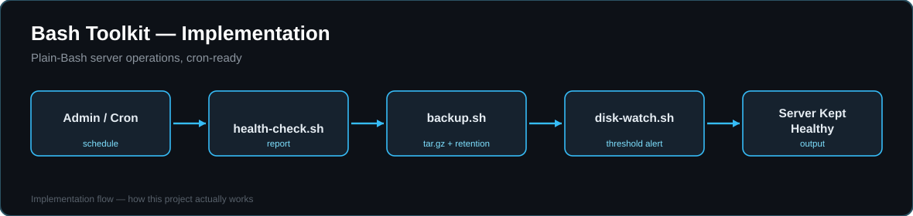

# Bash DevOps Toolkit




Small, dependency-free Bash scripts for day-to-day Linux server operations — the kind of checks I run on every server I manage. Each script is cron-safe, uses `set -euo pipefail`, and prints plain, loggable output.

## Scripts

### `scripts/health-check.sh`
One-shot health report: uptime/load, memory, key filesystem usage, top memory processes, and failed systemd services. Run it manually or mail yourself the output weekly from cron.

### `scripts/backup.sh`
Timestamped `tar.gz` backup of a directory with automatic retention cleanup.
```bash
./scripts/backup.sh /var/www /var/backups 7   # keep 7 days
```

### `scripts/disk-watch.sh`
Exits 1 and prints a warning when any filesystem crosses the threshold (default 85%) — built for cron + mail, or a monitoring hook:
```bash
*/30 * * * * /opt/bash-devops-toolkit/scripts/disk-watch.sh 85
```

## Notes

Practice-honed during my RHCSA and DevOps training — deliberately plain Bash (no external tools beyond coreutils/systemd) so it runs on any Linux box, from a fresh VPS to an air-gapped server.
